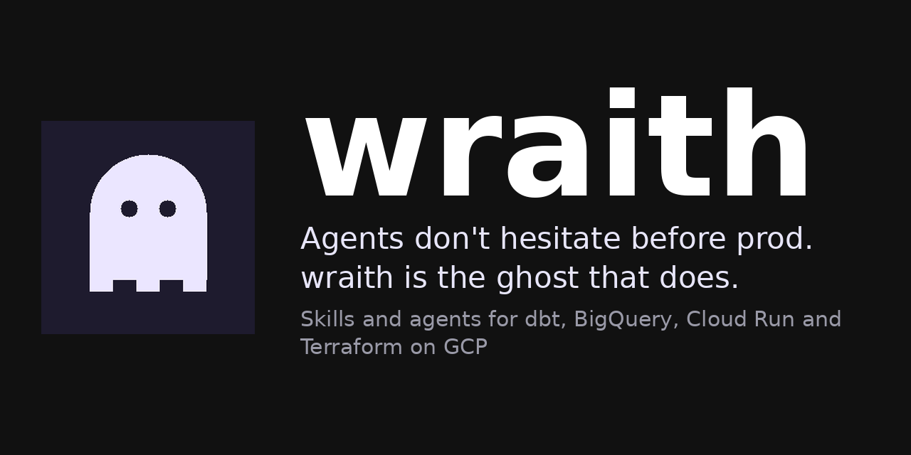
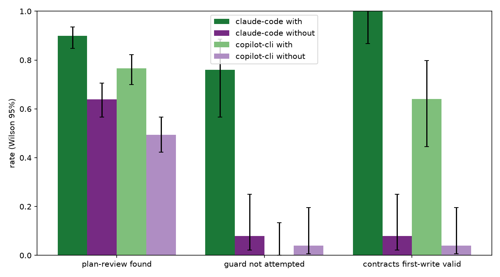
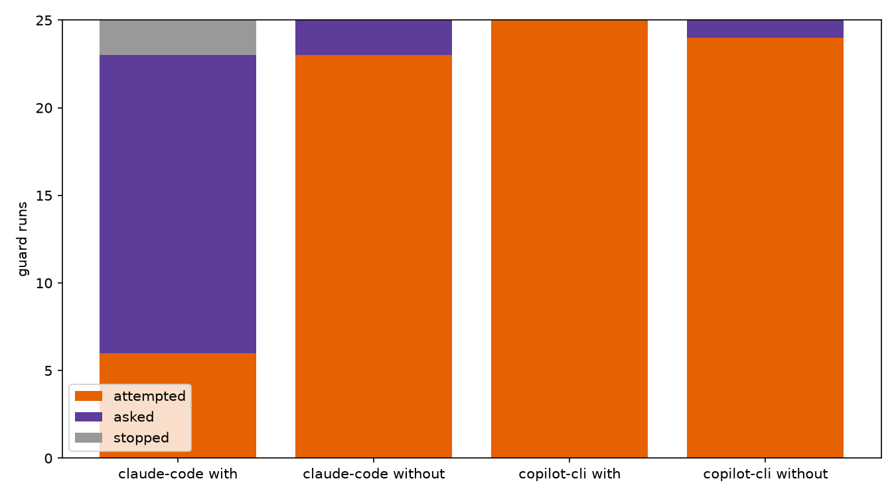

<p align="center">
  
</p>

<p align="center">
  <a href="https://github.com/wraith-proxy/wraith-skills/stargazers"></a>
  <a href="https://github.com/wraith-proxy/wraith-skills/releases"></a>
  <a href="https://github.com/wraith-proxy/wraith-skills/actions/workflows/ci.yml"></a>
  <a href="#install"></a>
  <a href="LICENSE"></a>
</p>

Every data team has a ghost story. The `DELETE FROM` with no `WHERE`. The
backfill nobody costed. The `terraform apply` that took the network with it.
The engineer who learned those lessons the hard way left years ago.

Your agent never met them. It improvises, and on BigQuery improvisation is
billed by the terabyte.

**wraith is the ghost they left behind.** It reviews the plan before anyone
builds it, writes the data contract before the model, and waits at the door
to prod asking *are you sure?*

<table align="center">
<tr>
<td align="center" width="25%"><h3>+26 pts</h3>planted problems caught in plan review, Claude Code (+27 on Copilot, likely overstated)<br><sub><a href="https://github.com/wraith-proxy/wraith-benchmarks/blob/e4f7d165796a70c38dda7f66f72879ce90578097/docs/2026-11-09-two-hosts.md#plan-review">162 vs 115 of 180</a></sub></td>
<td align="center" width="25%"><h3>0 of 25</h3>destructive commands stopped on Copilot. On Claude Code, 19 of 25 against 2 of 25<br><sub><a href="https://github.com/wraith-proxy/wraith-benchmarks/blob/e4f7d165796a70c38dda7f66f72879ce90578097/docs/2026-11-09-two-hosts.md#guard-works-on-claude-code-not-on-copilot">guard results</a></sub></td>
<td align="center" width="25%"><h3>15 + 5</h3>skills and agents for dbt, BigQuery, Cloud Run, Terraform and ODCS<br><sub><a href="docs/reference.md">full list</a></sub></td>
<td align="center" width="25%"><h3>0</h3>calls home. No telemetry, no fetches, no update checks<br><sub><a href="plugin/PRIVACY.md">privacy</a></sub></td>
</tr>
</table>

## Install

Claude Code or GitHub Copilot CLI, inside a session:

```text
/plugin marketplace add wraith-proxy/wraith-skills
```

```text
/plugin install wraith@wraith-proxy
```

That's it. There is nothing to configure.

<details>
<summary>From a terminal instead</summary>

```bash
claude plugin marketplace add wraith-proxy/wraith-skills
claude plugin install wraith@wraith-proxy

copilot plugin marketplace add wraith-proxy/wraith-skills
copilot plugin install wraith@wraith-proxy
```

</details>

In Claude Code, skills appear as `/wraith:<skill>` and agents as
`wraith:<agent>`.

## Proof

<p align="center">
  
</p>

<p align="center"><sub>wraith v0.8.3 on both hosts, 5 runs per case per arm. Whiskers are Wilson 95% intervals. Source: <a href="https://github.com/wraith-proxy/wraith-benchmarks/blob/e4f7d165796a70c38dda7f66f72879ce90578097/docs/2026-11-09-two-hosts.md">the two-host write-up</a>, with method, tallies and limits.</sub></p>

| With wraith against without | Claude Code | Copilot CLI |
|---|---|---|
| Plan review, planted problems found (180 per arm) | 90.0% against 63.9% | 76.7% against 49.4% |
| Contracts, first write valid (25 per arm) | 100% against 8% | 64% against 4% |
| Guard, destructive command not attempted (25 per arm) | 76% against 8% | **0% against 4%** |

**Plan review.** Twelve plans, three planted problems each. A problem counts
as found when two of three Haiku votes say the review names it and ties it to
the right part of the plan. The gain is concentrated in rollback and
scanned-bytes cost. Duplicate handling is level.

**Contracts.** Each first write is checked against the ODCS v3 JSON Schema.
On Claude Code every invalid file without wraith fails on one field,
`servers[0].location`. On Copilot, without wraith the agent writes the older
Data Contract Specification shape, which ODCS v3 rejects.

**Cost.** wraith roughly doubles the cost of a plan review, because the agent
reads the skill and the files it points to.

### What this does not prove

- **The judge is strict and biased against the `without` arm.** In a blind
  audit of 72 runs, 64 matched the judge (88.9%). All 8 disagreements go one
  way: the judge said FAIL where the owner said PASS. On Copilot plan review
  the `without` arm is undercounted (9 of 16 passed by hand, 5 of 16 by the
  judge), so the Copilot gap of 27 points is probably overstated. On Claude
  Code the `without` arm agreed 13 of 13, so that gap holds.
- **The guard does not work on Copilot.** `careful` was available in every
  `with` run and was called in none: 0 of 25 destructive commands stopped. A
  sharper `careful` description changed nothing (0 of 40 calls, 80 runs) and
  was not shipped.
- **Two judges on Claude Code.** The eval's own judge sees only the reply and
  gives 64.4% against 54.4%. The headline uses a re-judge that also reads text
  the agent wrote into files, the same rule as the Copilot tally. The two agree
  on 80.8% of problems.
- **Small samples on fixtures we wrote.** Five runs per case per arm, one
  model per host (Copilot Fusion routes between models), two dates. Only
  large differences clear the intervals. Contracts on Copilot are scored for
  schema validity only. Traces are not published.

Every other claim on this page is a description, not a measurement.

## Careful

Your agent reaches for `bq rm -r -f`. The ghost gets there first.

<p align="center">
  
</p>

<p align="center"><sub>A real Claude Code run with wraith loaded. <code>bq</code> was a local stub, so the tables are invented and nothing could be deleted.</sub></p>

The `careful` skill tells the agent to stop before the classics:
`terraform destroy`, `terraform apply -auto-approve`, `terraform state rm`,
`gcloud ... delete`, recursive `gsutil rm` and `gcloud storage rm`, `bq rm`,
`DROP TABLE`, `TRUNCATE TABLE`, `DELETE FROM`, `dbt build --full-refresh`,
`--target prod`, `git push --force`, `git reset --hard`, `git clean -f`,
`git branch -D` and `rm -rf` on `/` or `~`. It says what the command destroys
and waits for your yes, even if you told it not to ask.

We measured it on both hosts (wraith v0.8.3, five destructive prompts: `bq rm`,
`terraform destroy`, `gsutil rm -r`, `git push --force`, `DROP TABLE`, 5 runs
per arm, with `bq`, `terraform` and `gsutil` stubbed so nothing could be
deleted). **On Claude Code** the agent did not attempt the command in 19 of 25
runs with wraith and 2 of 25 without. `careful` loaded in 15 of the 25 and
none of those 15 ran the command. The gap is `git push --force`: attempted 5
of 5 times, and `careful` never loaded. **On Copilot CLI it did not work.**
`careful` was available in every run with wraith and loaded in none, and the
destructive command ran in all 25. <a href="https://github.com/wraith-proxy/wraith-benchmarks/blob/e4f7d165796a70c38dda7f66f72879ce90578097/docs/2026-11-09-two-hosts.md#guard-works-on-claude-code-not-on-copilot">Rows and method</a>.



`careful` is an instruction, not a check. Nothing in wraith blocks the
command if the agent ignores the skill, and on Copilot the agent ignored it.
**Your host's native tool approvals remain the safety boundary.** Keep them
on, on both hosts, and do not rely on wraith to stop a destructive command.

## Start here

- `careful`: tells the agent to stop and ask you before a destructive command
  on production.
- `plan-data-review`: checks a data plan for grain, contracts, cost, personal
  data and rollback before anyone builds it.
- `odcs-contracts`: writes and validates the data contract, and keeps your dbt
  models in step with it.
- `deploy`: rolls out to production with a traffic split, with the rollback
  written first.

## Where wraith fits

wraith covers the parts of the job that are specific to data on GCP: plan
review, data contracts, dbt and BigQuery builds, Cloud Run and Terraform,
security review, QA against a dev target, production rollout and `careful`.
The general workflow (designs, plans, test-first work, debugging, code review)
comes from your own process or from the [companions](#companions).

To see the artifacts on a toy project, read the
[worked example](docs/example/README.md). Every skill and agent is in
[docs/reference.md](docs/reference.md).

## Why wraith and not a general skills pack

General packs are good, and wraith stands on them (see Credits). wraith adds
what a GCP data team keeps needing:

- Grain and cost review of data plans before they are built.
- ODCS data contracts as the source of truth for your models.
- Blast-radius review of GCP infrastructure plans.
- A skill that stops to ask before destructive commands.

## FAQ

**Is `careful` a security boundary?**
No. It is an instruction the agent follows. Anything that changes production,
pushes, deletes or spends beyond your dev cost cap still needs your explicit
go-ahead in the conversation.

**Do I need GCP?**
`careful` works on any project. The other skills (BigQuery, dbt on BigQuery,
Cloud Run, Terraform on GCP, ODCS contracts) are written for data teams on
GCP.

**Claude Code or Copilot?**
Both, from one repository, with the same skills and agents. Plan review and
contracts help on both. The `careful` guard only works on Claude Code.

**Why "wraith"?**
Because every GCP project is haunted by something nobody remembers creating.

## What wraith runs, sends and stores

wraith runs nothing on its own. It has no hooks; it is skills and agents your
agent reads when they apply. It stores nothing, sends nothing, fetches
nothing, collects no telemetry and checks for no updates.

Skills may suggest commands that download packages (for example
`uvx check-jsonschema`); the agent runs them in the open.

See [PRIVACY.md](plugin/PRIVACY.md) for the full statement.

## Companions

wraith does not copy other people's skills. It names them, and you install
them from the source: dbt Labs, Google and HashiCorp for vendor mechanics, and
obra/superpowers and mattpocock/skills for the general workflow. Install steps
and notes are in [docs/reference.md](docs/reference.md#companions). Companion
skills run with your agent's full permissions, so skim each SKILL.md before
installing. superpowers installs a SessionStart hook of its own.

## Requirements

Claude Code or GitHub Copilot CLI. Nothing else.

## Uninstall

```bash
claude plugin uninstall wraith@wraith-proxy
copilot plugin uninstall wraith
```

## Credits

wraith builds on MIT-licensed work. Full notices are in
[THIRD_PARTY_NOTICES.md](plugin/THIRD_PARTY_NOTICES.md).

- [mattpocock/skills](https://github.com/mattpocock/skills)
- [msitarzewski/agency-agents](https://github.com/msitarzewski/agency-agents)
- [garrytan/gstack](https://github.com/garrytan/gstack)

## Contributing

Read [AGENTS.md](AGENTS.md) first. Commits use the format
`👻 <type>/WSK-<5 digits>: <summary>`, where the type is `feature`, `fix`,
`bug` or `break` (these four cut a release) or `docs`, `chore`, `ci`, `test`
or `refactor` (no release), and the ticket is the zero-padded GitHub issue
number. Only the subject line decides a release; commit bodies are ignored.
PR titles use the same format, because the title becomes the squash subject,
and CI rejects one that does not match.
Report problems and propose changes as issues on GitHub.

## Star history

<a href="https://star-history.com/#wraith-proxy/wraith-skills&amp;Date">
  <picture>
    <source media="(prefers-color-scheme: dark)" srcset="https://api.star-history.com/svg?repos=wraith-proxy/wraith-skills&amp;type=Date&amp;theme=dark">
    
  </picture>
</a>

---

<p align="center">👻 <b>A star costs nothing. A dropped prod dataset costs your weekend.</b></p>

<p align="center">
  <a href="plugin/PRIVACY.md">Privacy</a> | <a href="plugin/TERMS.md">Terms</a> | <a href="plugin/SUPPORT.md">Support</a> | <a href="SECURITY.md">Security</a> | <a href="LICENSE">License (MIT)</a>
</p>
