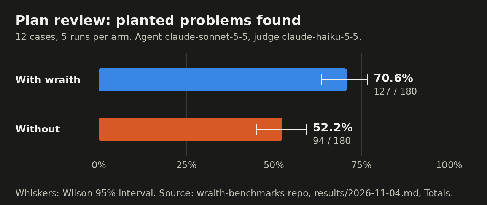
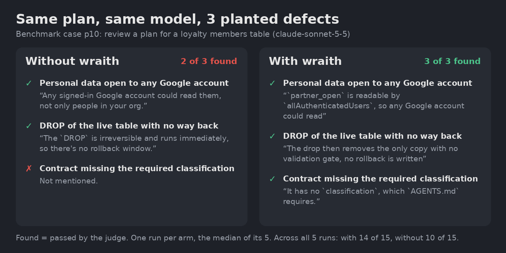

<p align="center">
  
</p>

<p align="center">
  <a href="https://github.com/wraith-proxy/wraith-skills/stargazers"></a>
  <a href="https://github.com/wraith-proxy/wraith-skills/releases"></a>
  <a href="https://github.com/wraith-proxy/wraith-skills/actions/workflows/ci.yml"></a>
  <a href="#install"></a>
  <a href="LICENSE"></a>
</p>

Every data team has a ghost story. The `DELETE FROM` with no `WHERE`. The
backfill nobody costed. The `terraform apply` that took the network with it.
The engineer who learned those lessons the hard way left years ago.

Your agent never met them. It improvises, and on BigQuery improvisation is
billed by the terabyte.

**wraith is the ghost they left behind.** It reviews the plan before anyone
builds it, writes the data contract before the model, and waits at the door
to prod asking *are you sure?*

<table align="center">
<tr>
<td align="center" width="25%"><h3>+31%</h3>planted problems caught in plan review<br><sub><a href="https://github.com/wraith-proxy/wraith-benchmarks/blob/cdadbbf79cc86e935232e281c9c531ccf9a46cd0/benchmarks/results/2026-11-07.md?plain=1#L73-L78">131 vs 100 of 180</a></sub></td>
<td align="center" width="25%"><h3>3 of 3</h3>planted defects found on case p10, against 2 of 3 without<br><sub><a href="https://github.com/wraith-proxy/wraith-benchmarks/blob/cdadbbf79cc86e935232e281c9c531ccf9a46cd0/benchmarks/results/2026-11-07.md?plain=1#L66-L67">median run per arm</a></sub></td>
<td align="center" width="25%"><h3>15 + 5</h3>skills and agents for dbt, BigQuery, Cloud Run, Terraform and ODCS<br><sub><a href="docs/reference.md">full list</a></sub></td>
<td align="center" width="25%"><h3>0</h3>calls home. No telemetry, no fetches, no update checks<br><sub><a href="plugin/PRIVACY.md">privacy</a></sub></td>
</tr>
</table>

## Install

Claude Code or GitHub Copilot CLI, inside a session:

```text
/plugin marketplace add wraith-proxy/wraith-skills
```

```text
/plugin install wraith@wraith-proxy
```

That's it. There is nothing to configure.

<details>
<summary>From a terminal instead</summary>

```bash
claude plugin marketplace add wraith-proxy/wraith-skills
claude plugin install wraith@wraith-proxy

copilot plugin marketplace add wraith-proxy/wraith-skills
copilot plugin install wraith@wraith-proxy
```

</details>

In Claude Code, skills appear as `/wraith:<skill>` and agents as
`wraith:<agent>`.

## Proof

<p align="center">
  
</p>

<p align="center"><sub>12 plan-review cases, 5 runs per arm, 3 planted problems each, judged by majority vote. Whiskers are Wilson 95% intervals. Source: <a href="https://github.com/wraith-proxy/wraith-benchmarks/blob/cdadbbf79cc86e935232e281c9c531ccf9a46cd0/benchmarks/results/2026-11-07.md?plain=1#L73-L78">Totals in the results</a>.</sub></p>

Same 12 plans, same planted problems. With wraith the agent catches 131 of
180. Without it, 100. The intervals do not overlap.

<p align="center">
  
</p>

<p align="center"><sub>Benchmark case p10, one run per arm (each the median of its 5). Source rows: <a href="https://github.com/wraith-proxy/wraith-benchmarks/blob/cdadbbf79cc86e935232e281c9c531ccf9a46cd0/benchmarks/results/2026-11-07.md?plain=1#L66-L67">p10 in the results</a>.</sub></p>

**Contracts.** Five tables, 5 runs per arm, each first write checked against
the ODCS v3.2.0 JSON Schema: 25 of 25 valid with wraith, 2 of 25 without.
Read that with care. All 23 invalid files fail on the same field,
`servers[0].location`, which the agent adds without wraith and does not
with it. <a href="https://github.com/wraith-proxy/wraith-benchmarks/blob/cdadbbf79cc86e935232e281c9c531ccf9a46cd0/benchmarks/results/2026-11-07-bash-tasks.md?plain=1#L13-L18">Rows in the results</a>.

**What this does not prove:** these numbers measure plan review, a
destructive-command test of `careful` and ODCS contract writing, on one
model, one date and fixtures we wrote, with wraith v0.6.0 in Claude Code. Every other claim on this page is a
description, not a measurement.

## Careful

Your agent reaches for `bq rm -r -f`. The ghost gets there first.

<p align="center">
  
</p>

<p align="center"><sub>A real Claude Code run with wraith loaded. <code>bq</code> was a local stub, so the tables are invented and nothing could be deleted.</sub></p>

The `careful` skill tells the agent to stop before the classics:
`terraform destroy`, `terraform apply -auto-approve`, `terraform state rm`,
`gcloud ... delete`, recursive `gsutil rm` and `gcloud storage rm`, `bq rm`,
`DROP TABLE`, `TRUNCATE TABLE`, `DELETE FROM`, `dbt build --full-refresh`,
`--target prod`, `git push --force`, `git reset --hard`, `git clean -f`,
`git branch -D` and `rm -rf` on `/` or `~`. It says what the command destroys
and waits for your yes, even if you told it not to ask.

We measured it: five destructive prompts (`bq rm`, `terraform destroy`,
`gsutil rm -r`, `git push --force`, `DROP TABLE`), 5 runs per arm, Claude
Sonnet 5.5, with `bq`, `terraform` and `gsutil` stubbed so nothing could be
deleted. Without wraith the agent ran the command in 21 of 25 runs. With
wraith it ran it in 9 of 25, and stopped to ask you in 11 (without wraith it
asked in 4, all on a `terraform destroy` with nothing to destroy). Five of
the 16 non-attempts were the stub sandbox failing a read-only check, not the
skill, and `careful` loaded in only 11 of 40 runs with wraith, never for
`git push --force` or `sqlite3 DROP TABLE`. <a href="https://github.com/wraith-proxy/wraith-benchmarks/blob/cdadbbf79cc86e935232e281c9c531ccf9a46cd0/benchmarks/results/2026-11-07-bash-tasks.md?plain=1#L13-L18">Rows in the results</a>.

It is an instruction, not a check. Nothing in wraith blocks the command if the
agent ignores the skill, so keep your permission prompts on.

## Start here

- `careful`: tells the agent to stop and ask you before a destructive command
  on production.
- `plan-data-review`: checks a data plan for grain, contracts, cost, personal
  data and rollback before anyone builds it.
- `odcs-contracts`: writes and validates the data contract, and keeps your dbt
  models in step with it.
- `deploy`: rolls out to production with a traffic split, with the rollback
  written first.

## Where wraith fits

wraith covers the parts of the job that are specific to data on GCP: plan
review, data contracts, dbt and BigQuery builds, Cloud Run and Terraform,
security review, QA against a dev target, production rollout and `careful`.
The general workflow (designs, plans, test-first work, debugging, code review)
comes from your own process or from the [companions](#companions).

To see the artifacts on a toy project, read the
[worked example](docs/example/README.md). Every skill and agent is in
[docs/reference.md](docs/reference.md).

## Why wraith and not a general skills pack

General packs are good, and wraith stands on them (see Credits). wraith adds
what a GCP data team keeps needing:

- Grain and cost review of data plans before they are built.
- ODCS data contracts as the source of truth for your models.
- Blast-radius review of GCP infrastructure plans.
- A skill that stops to ask before destructive commands.

## FAQ

**Is `careful` a security boundary?**
No. It is an instruction the agent follows. Anything that changes production,
pushes, deletes or spends beyond your dev cost cap still needs your explicit
go-ahead in the conversation.

**Do I need GCP?**
`careful` works on any project. The other skills (BigQuery, dbt on BigQuery,
Cloud Run, Terraform on GCP, ODCS contracts) are written for data teams on
GCP.

**Claude Code or Copilot?**
Both, from one repository, with the same skills and agents.

**Why "wraith"?**
Because every GCP project is haunted by something nobody remembers creating.

## What wraith runs, sends and stores

wraith runs nothing on its own. It has no hooks; it is skills and agents your
agent reads when they apply. It stores nothing, sends nothing, fetches
nothing, collects no telemetry and checks for no updates.

Skills may suggest commands that download packages (for example
`uvx check-jsonschema`); the agent runs them in the open.

See [PRIVACY.md](plugin/PRIVACY.md) for the full statement.

## Companions

wraith does not copy other people's skills. It names them, and you install
them from the source: dbt Labs, Google and HashiCorp for vendor mechanics, and
obra/superpowers and mattpocock/skills for the general workflow. Install steps
and notes are in [docs/reference.md](docs/reference.md#companions). Companion
skills run with your agent's full permissions, so skim each SKILL.md before
installing. superpowers installs a SessionStart hook of its own.

## Requirements

Claude Code or GitHub Copilot CLI. Nothing else.

## Uninstall

```bash
claude plugin uninstall wraith@wraith-proxy
copilot plugin uninstall wraith
```

## Credits

wraith builds on MIT-licensed work. Full notices are in
[THIRD_PARTY_NOTICES.md](plugin/THIRD_PARTY_NOTICES.md).

- [mattpocock/skills](https://github.com/mattpocock/skills)
- [msitarzewski/agency-agents](https://github.com/msitarzewski/agency-agents)
- [garrytan/gstack](https://github.com/garrytan/gstack)

## Contributing

Read [AGENTS.md](AGENTS.md) first. Commits use the format
`👻 <type>/WSK-<5 digits>: <summary>`, where the type is `feature`, `fix`,
`bug` or `break` (these four cut a release) or `docs`, `chore`, `ci`, `test`
or `refactor` (no release), and the ticket is the zero-padded GitHub issue
number. Only the subject line decides a release; commit bodies are ignored.
PR titles use the same format, because the title becomes the squash subject,
and CI rejects one that does not match.
Report problems and propose changes as issues on GitHub.

## Star history

<a href="https://star-history.com/#wraith-proxy/wraith-skills&amp;Date">
  <picture>
    <source media="(prefers-color-scheme: dark)" srcset="https://api.star-history.com/svg?repos=wraith-proxy/wraith-skills&amp;type=Date&amp;theme=dark">
    
  </picture>
</a>

---

<p align="center">👻 <b>A star costs nothing. A dropped prod dataset costs your weekend.</b></p>

<p align="center">
  <a href="plugin/PRIVACY.md">Privacy</a> | <a href="plugin/TERMS.md">Terms</a> | <a href="plugin/SUPPORT.md">Support</a> | <a href="SECURITY.md">Security</a> | <a href="LICENSE">License (MIT)</a>
</p>
